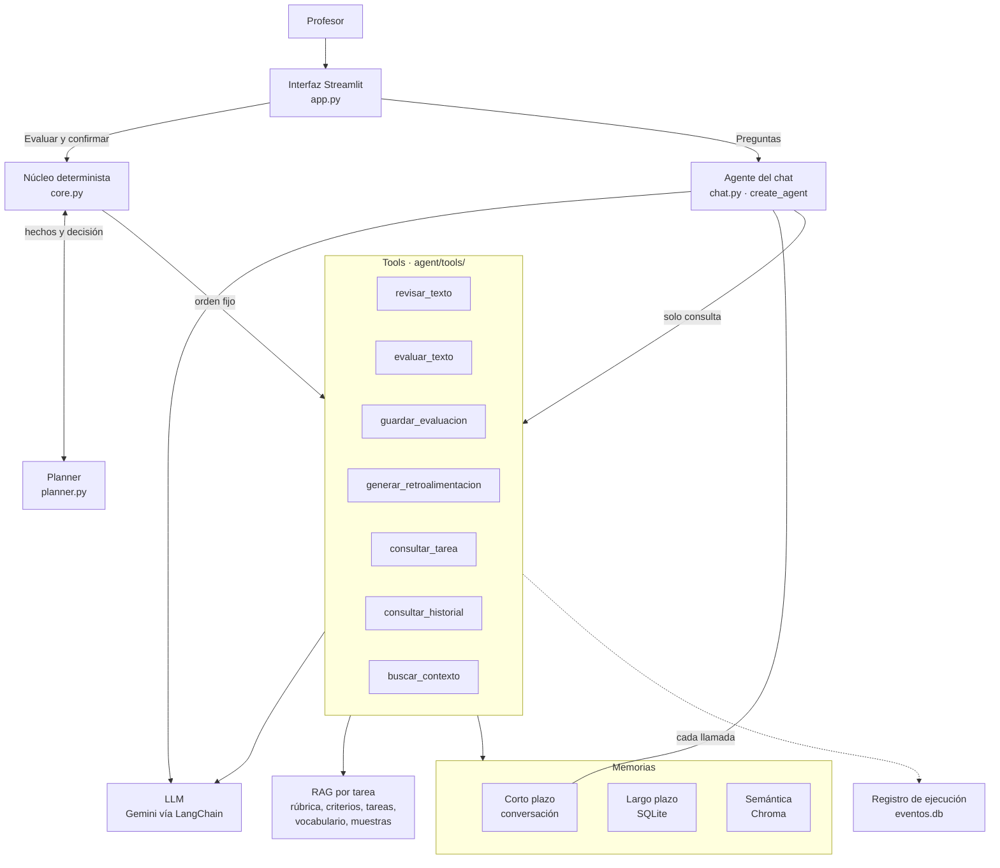
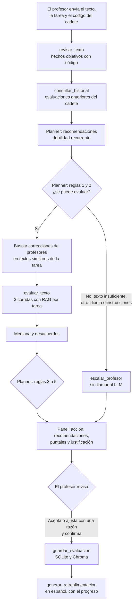
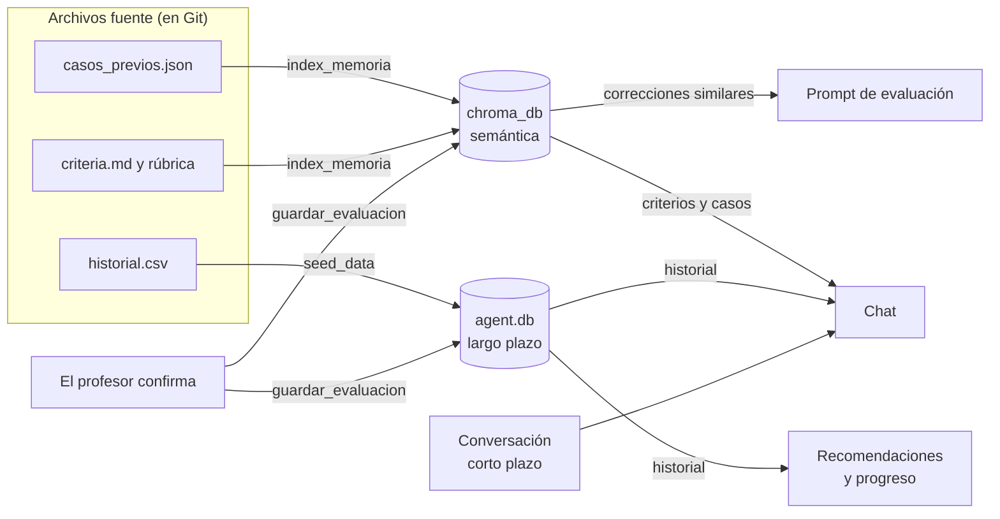

# Agente de evaluación de escritura A2

Agente de IA que asiste a los profesores de inglés de una academia militar chilena en la evaluación de textos escritos por cadetes (nivel A2 y A2+). Evalúa cada texto con la escala de Cambridge y los criterios de la academia, decide qué necesita cada caso, recuerda el historial de cada cadete, responde preguntas del profesor y redacta retroalimentación para el cadete.

**El agente propone; el profesor decide.** Ningún puntaje se guarda ni se entrega al cadete sin la confirmación del profesor.

Este repositorio corresponde a la Etapa 2 del proyecto. La Etapa 1 construyó el pipeline RAG de evaluación; aquí ese pipeline se convierte en una herramienta dentro de un agente con planificación, memoria y un chat.

## Contenido

- [Qué hace y qué no hace](#qué-hace-y-qué-no-hace)
- [Inicio rápido](#inicio-rápido)
- [Arquitectura](#arquitectura)
- [Flujo de una evaluación](#flujo-de-una-evaluación)
- [Planner](#planner)
- [Tools](#tools)
- [Memorias](#memorias)
- [Chat](#chat)
- [Estructura del proyecto](#estructura-del-proyecto)
- [Observabilidad](#observabilidad)
- [Evaluación](#evaluación)
- [Decisiones de diseño](#decisiones-de-diseño)
- [Limitaciones](#limitaciones)

## Qué hace y qué no hace

**Hace:**
- Revisa cada texto con código: extensión, saludo, vocabulario enseñado, palabras en español e intentos de manipular la evaluación.
- Evalúa el texto 3 veces con el LLM (RAG por tarea) y propone la mediana de los puntajes.
- Decide cómo debe revisarlo el profesor y recomienda refuerzos para el cadete.
- Recuerda el historial de cada cadete y las correcciones de los profesores.
- Responde preguntas abiertas en un chat de solo lectura, con preguntas sugeridas.
- Redacta retroalimentación en español para el cadete, a partir de los puntajes confirmados.

**No hace:**
- Asignar notas finales ni enviar retroalimentación sin confirmación del profesor.
- Cambiar puntajes desde el chat.
- Modificar la rúbrica ni los criterios.
- Guardar nombres o grados: los cadetes se identifican solo con códigos (`CDT-004`).

## Inicio rápido

### 1. Instalación

```bash
python3 -m venv .venv
source .venv/bin/activate
pip install torch --index-url https://download.pytorch.org/whl/cpu
pip install -r requirements.txt
```

La primera línea de `pip` instala la versión de PyTorch para CPU, mucho más liviana; la necesita el modelo de embeddings de la memoria semántica.

### 2. Configuración

Crear un archivo `.env` en la carpeta principal (no se sube al repositorio):

```
GOOGLE_API_KEY=AIzaSy...
LLM_PROVIDER=google
LLM_MODEL=gemini-3.5-flash-lite
HF_HUB_OFFLINE=1
```

La clave de Gemini se obtiene gratis en Google AI Studio. `HF_HUB_OFFLINE=1` evita que el modelo de embeddings consulte internet cada vez que se carga; debe agregarse después de la primera ejecución de `index_memoria`, que lo descarga.

### 3. Preparar las memorias

```bash
python -m scripts.seed_data        # historial ficticio de cadetes (SQLite)
python -m scripts.index_memoria    # criterios y casos previos (Chroma)
```

Estos comandos también **reinician** las memorias a su estado inicial. Conviene ejecutarlos antes de una demostración o una evaluación, porque cada confirmación agrega datos.

### 4. Ejecutar

```bash
streamlit run app.py               # interfaz
pytest -v                          # pruebas automatizadas
python -m scripts.evaluate_agent   # evaluación con los textos de evaluation/
```

Todos los comandos se ejecutan desde la carpeta principal, con `python -m`, para que Python encuentre los paquetes del proyecto.

## Arquitectura

El agente sigue un diseño **híbrido**:

- **Flujo determinista** (`core.py`): para evaluar un texto, siempre se ejecutan las mismas tools en el mismo orden, y un **planner** basado en reglas decide la acción. Así cada decisión es trazable y se puede probar.
- **Agente con LLM** (`chat.py`): para las preguntas abiertas del profesor, el modelo decide qué tool usar. Solo tiene tools de consulta.



## Flujo de una evaluación



Puntos clave del flujo:

- **Las reglas 1 y 2 se aplican antes del LLM.** Los textos que no deben evaluarse nunca llegan al modelo.
- **La memoria se lee antes de decidir y se escribe después de confirmar.** Las propuestas no confirmadas nunca entran en la memoria.
- **La retroalimentación se genera con los puntajes finales del profesor**, no con la propuesta del modelo.
- **El historial no se envía al LLM al evaluar.** El texto se califica por sí mismo; el historial solo influye en las recomendaciones.

## Planner

El planner (`agent/planner.py`) responde dos preguntas distintas, que no compiten entre sí.

**¿Cómo debe revisar el profesor este texto?** Una sola acción. Las reglas se evalúan en orden y se aplica la primera que se cumple:

| # | Condición | Acción |
|---|---|---|
| 1 | Texto vacío o con menos del 20% de las palabras mínimas | `escalar_profesor` |
| 2 | Más del 30% de palabras en español, o instrucciones dirigidas al sistema | `escalar_profesor` |
| 3 | Las corridas difieren en 1 banda o más en algún criterio, o menos de 2 corridas válidas | `caso_dudoso` |
| 4 | Puntaje total menor que 9 de 15 | `priorizar_revision` |
| 5 | Ninguna de las anteriores | `revision_rapida` |

**¿Qué necesita este cadete?** Recomendaciones que se muestran siempre, cualquiera sea la acción:

| Condición | Recomendación |
|---|---|
| Una misma debilidad aparece por tercera vez, contando el texto actual | `recomendar_refuerzo` |

El detalle y la justificación del orden están en [`docs/reglas.md`](docs/reglas.md).

## Tools

| # | Tool | Tipo | Qué hace |
|---|---|---|---|
| 1 | `consultar_tarea` | Consulta | Devuelve la ficha de una tarea: puntos de contenido, extensión, saludo, gramática y vocabulario |
| 2 | `revisar_texto` | Razonamiento (código) | Mide extensión, saludo, vocabulario enseñado, palabras en español e instrucciones sospechosas |
| 3 | `evaluar_texto` | Razonamiento (LLM + RAG) | Evalúa 3 veces y calcula la mediana, el rango y los desacuerdos |
| 4 | `consultar_historial` | Consulta (largo plazo) | Devuelve las evaluaciones anteriores de un cadete |
| 5 | `buscar_contexto` | Consulta (semántica) | Busca por significado en los criterios y en casos anteriores |
| 6 | `guardar_evaluacion` | Escritura | Guarda la evaluación confirmada en SQLite y Chroma; exige una razón para cada ajuste |
| 7 | `generar_retroalimentacion` | Escritura (LLM) | Redacta la retroalimentación en español y la verifica con código |

Todas usan `@tool` de LangChain y registran su ejecución. Los contratos completos están en [`docs/tools.md`](docs/tools.md).

## Memorias

| Memoria | Qué recuerda | Dónde | Se lee | Se escribe | Se reinicia con |
|---|---|---|---|---|---|
| **Corto plazo** | La conversación del chat | RAM (`st.session_state`) | En cada pregunta del chat | En cada respuesta | "Clear conversation" o recargar la página |
| **Largo plazo** | Evaluaciones confirmadas por cadete: puntajes propuestos y finales, ajustes, razones, debilidades | SQLite (`data/agent.db`) | Al evaluar (recomendaciones y progreso) y en el chat | Al confirmar | `python -m scripts.seed_data` |
| **Semántica** | Criterios por sección y casos confirmados (resumen en inglés generado por código + texto) | Chroma (`data/chroma_db/`) | Al evaluar (correcciones similares) y en el chat | Al confirmar | `python -m scripts.index_memoria` |



**Cómo influye cada memoria:**

- **Largo plazo:** si una debilidad aparece por tercera vez, el planner recomienda reforzarla. La retroalimentación al cadete menciona su progreso (debilidades superadas o persistentes), calculado con código.
- **Semántica:** cuando un profesor ajusta un puntaje con una razón, ese caso queda guardado. Al evaluar un texto similar de la misma tarea, la corrección se incluye en el prompt como ejemplo. El agente se adapta sin reentrenar el modelo, y se puede ver qué corrección usó.
- **Corto plazo:** el chat entiende preguntas de seguimiento ("¿y qué debilidades tiene?") según lo conversado.

**Separación de datos:** los textos de `evaluation/` nunca se usan en la demostración ni en la base de conocimiento, para que la evaluación sea válida. Los textos de la demostración (`data/demo_textos.json`) son sintéticos.

## Chat

El chat usa `create_agent` de LangChain: el modelo recibe la pregunta, decide qué tool usar, lee el resultado y repite hasta poder responder (máximo 10 pasos).

- **Solo lectura:** tiene `consultar_tarea`, `consultar_historial` y `buscar_contexto`. No puede evaluar, cambiar puntajes ni guardar.
- **Contexto:** recibe la conversación (memoria de corto plazo) y la evaluación abierta en el panel.
- **Transparencia:** bajo cada respuesta se muestran las tools usadas con sus argumentos, por ejemplo `consultar_historial(cadete_id=CDT-002)`.
- **Preguntas sugeridas:** botones que cambian según el momento (sin texto, después de evaluar, caso dudoso), para profesores que no saben qué preguntar.

## Estructura del proyecto

```
english-feedback-agent/
├── app.py                        # Interfaz Streamlit: panel de revisión y chat
├── requirements.txt              # Librerías
├── pytest.ini                    # Configuración de pytest
├── .env                          # Claves y modelo (no se sube al repositorio)
│
├── agent/                        # Código del agente
│   ├── core.py                   # Flujo de evaluación y confirmación
│   ├── planner.py                # Reglas de decisión y recomendaciones
│   ├── chat.py                   # Agente del chat y memoria de corto plazo
│   ├── llm.py                    # Creación del modelo y llamadas con reintentos
│   ├── prompts.py                # Prompts de evaluación (inglés) y retroalimentación (español)
│   ├── observability.py          # Registro de ejecución
│   ├── tools/                    # Las 7 tools
│   ├── memory/
│   │   ├── long_term.py          # Memoria de largo plazo (SQLite)
│   │   └── semantic.py           # Memoria semántica (Chroma)
│   └── rag/                      # Recuperación y revisiones de la Etapa 1
│       ├── retrieval.py
│       └── checks.py
│
├── config/
│   └── settings.py               # Rutas, umbrales y parámetros, en un solo lugar
│
├── data/                         # Base de conocimiento y datos ficticios
│   ├── rubric_cambridge_a2.md    # Escala de Cambridge (fuente externa)
│   ├── criteria.md               # Criterios institucionales
│   ├── tasks/                    # Una ficha por tarea
│   ├── vocabulary/               # Vocabulario adicional (military.md)
│   ├── samples/                  # Muestras calificadas (few-shot)
│   ├── cadetes.csv, historial.csv  # Cadetes e historial ficticios
│   ├── casos_previos.json        # Correcciones ficticias para la memoria semántica
│   ├── demo_textos.json          # Textos sintéticos para la demostración
│   ├── agent.db                  # Memoria de largo plazo (generada)
│   ├── chroma_db/                # Memoria semántica (generada)
│   └── eventos.db                # Registro de ejecución (generado)
│
├── evaluation/                   # Textos reales de prueba con los puntajes originales
├── scripts/
│   ├── generate_mock_data.py     # Genera los datos ficticios
│   ├── seed_data.py              # Carga y reinicia el historial
│   ├── index_memoria.py          # Construye y reinicia la memoria semántica
│   ├── evaluate_agent.py         # Evalúa el agente con evaluation/
│   └── verify_llm.py             # Verifica la conexión con el modelo
│
├── tests/                        # 85 pruebas automatizadas
├── docs/
│   ├── alcance.md                # Propósito, alcance y métricas de éxito
│   ├── tools.md                  # Contratos de las tools
│   └── reglas.md                 # Reglas del planner
└── evidence/
    ├── stage1/                   # Resultados de la Etapa 1 (MiniMax y Nemotron)
    └── stage2/                   # Evaluaciones del agente y salida del chat
```

Los archivos generados (`agent.db`, `chroma_db/`, `eventos.db`) no se suben al repositorio: se reconstruyen con los scripts.

## Observabilidad

El agente se preparó para la Etapa 3 desde el inicio:

- **Registro de ejecución** (`data/eventos.db`): una fila por cada llamada a una tool o al LLM, con hora, sesión, modelo, duración, tokens, resultado y tipo de error. Está separado de las memorias, por lo que reiniciarlas no lo borra.
- **Códigos de error fijos:** `overloaded`, `rate_limit`, `timeout`, `empty_response`, `missing_scores`, `llm_failed`, `feedback_check_failed`.
- **Cada evaluación guarda** las 3 corridas, el puntaje propuesto, el puntaje final del profesor, el modelo y la versión del prompt.

## Evaluación

`scripts/evaluate_agent.py` ejecuta el agente con los cuatro textos reales de `evaluation/` y compara sus propuestas con los puntajes originales de la profesora. Los resultados se guardan en `evidence/stage2/`, en una carpeta por ejecución con el modelo y la versión del prompt.

| Sistema | Dentro del rango de la profesora | A 0,5 o menos | Diferencia promedio |
|---|---|---|---|
| Nemotron 3 Super, Etapa 1 (mejor ejecución) | 67% | 83% | 0,38 |
| gemini-3.5-flash-lite, prompt v2 | 33% | 67% | 0,71 |
| **gemini-3.5-flash-lite, prompt v3 (promedio de 3)** | **64%** | **80%** | **0,35** |

La versión v3 reescribió la sección Content de los criterios, que no orientaba sobre las bandas inferiores. El análisis completo está en [`evidence/stage2/comparacion.md`](evidence/stage2/comparacion.md).

## Decisiones de diseño

- **Gemini a través de LangChain**, con el proveedor y el modelo en `.env`: cambiar de modelo no requiere modificar el código. Se eligió `gemini-3.5-flash-lite` porque `gemini-3.8-flash` respondía con errores de sobrecarga.
- **Tres corridas por texto con mediana baja (`median_low`)**: este modelo ignora la temperatura, por lo que la consistencia se controla comparando corridas. La mediana baja garantiza que el puntaje propuesto sea uno que alguna corrida asignó.
- **Hechos objetivos con código, no con el LLM**: conteo de palabras, saludo, idioma, vocabulario y progreso se calculan con código, porque son reglas exactas.
- **Acción y recomendaciones separadas en el planner**: una debilidad recurrente no cambia cómo se califica el texto, pero el profesor siempre debe conocerla.
- **`create_agent` en lugar de `AgentExecutor`**: `AgentExecutor` y `ConversationBufferMemory` ya no existen en LangChain 1.x; la memoria de corto plazo se implementó con una clase propia.
- **Pruebas sin llamar al modelo**: un LLM falso, embeddings falsos y bases de datos temporales permiten probar todo el agente en segundos y sin internet.

## Limitaciones

- La evaluación usa cuatro textos de una sola tarea y los puntajes de una sola profesora; los resultados son indicativos.
- La mediana protege contra una corrida atípica, pero no contra errores sistemáticos ni contra una mayoría de corridas erradas.
- La búsqueda semántica compara el tema de los textos más que su estilo, y siempre devuelve los `k` resultados más cercanos, aunque no sean relevantes.
- Una corrección del profesor puede influir en criterios distintos al corregido.
- Los modelos gratuitos se saturan con frecuencia; los reintentos lo resuelven, a costa de tiempo.

## Privacidad

Los textos de los estudiantes se anonimizan: los cadetes se identifican solo con códigos. La clave del modelo se guarda en `.env`, que no se sube al repositorio. El repositorio es privado.